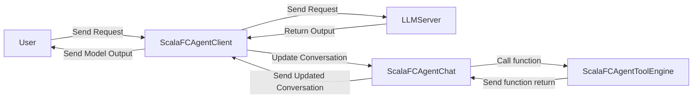

# function-calling-made-by-FP
関数型言語でFunction Calling Frameworkを実装する。ScalaFCAgentはLLMServerとUserの間に立ち, Userからのリクエストを振り分け, Toolの呼び出しを行いLLMServerに返す処理を担当する。
(2026/10/15追記): ScalaFCAgentをリクエストのSend Receiveを管理するScalaFCAgentClientと実行中の会話を管理するScalaFCAgentChat, Tool呼び出しを処理するScalaFCAgentToolEngineに分けた


# ドキュメント

- [Quick Start](docs/quickstart.md)
- [Reference: コア (Agent / Chat / Tool / LLMServer / Client)](docs/reference/core.md)
- [Reference: HTTPサーバ (server)](docs/reference/http-server.md)

# 責務
- ScalaFCAgentClient
UserとScalaFCAgentChatからのリクエストを受け取りLLMServerへリクエストを送り, 出力に応じてUserとScalaFCAgentChatにリクエストを返す
- ScalaFCAgentChat
ScalaFCAgentClientから文章を受け取り, system, user, assistant, thinking, toolなどの`Role`に割り振る。ScalaFCAgentClientの入力を構築する。
- ScalaFCAgentTool
ScalaFCAgentChatの結果に応じてTool呼び出しを担当する
- LLMServer
外部, vLLMとollamaなどのOpenAI互換のAPIを提供していることを想定

# Prompt設計
Functionの呼び出しは以下のようになる。今のところはXML型のFunction Callingのみを扱うが, 将来的にはYML型のものを扱えるようにする
```
<tool>
{
    "function_name": String,
    "arguments": String (JSON)
}
</tool>
```
返信も以下のようになる
```
<tool_result>
String
</tool_result>
```

## 会話の組み立て
`<tool>` / `<tool_result>` はTool呼び出しの形式であり, それ以外の会話はOpenAI互換APIの`messages`として`Role`ごとに分けて送る。

```json
{"messages":[
  {"role":"system","content":"... (Toolの説明を含む)"},
  {"role":"user","content":"..."},
  {"role":"assistant","content":"..."}
]}
```

ロールごとのタグ付け (chat template) は接続先のOpenAI互換サーバが行うため, こちらでは行わない。こちらが面倒を見るのはサーバが関与しない`<tool>` / `<tool_result>` の形式だけ。`Role`の写像は以下の通り。

| Role | OpenAI互換APIのrole |
| --- | --- |
| `Role.System` | `system` |
| `Role.User` | `user` |
| `Role.Assistant` | `assistant` |
| `Role.Thinking` | `assistant` |
| `Role.Tool` | `user` (ネイティブのtools APIを使わないため) |

Toolsが無い場合は`system` / `user` / `assistant`だけになり, 普通のUserとLLMServerの会話になる。

# How to use
- 公開用APIの`class Agent`に`trait Tool`を継承したclassを使う。
- Configを書く
- TODO: Write how to use

## HTTPラッパー / 実行例
`server`モジュールにHTTPラッパーを置いている(コアの`lib`に重い依存を持ち込まないため別モジュール)。OpenAI互換の`POST /v1/chat/completions`を提供し, 状態は持たない(`messages`を毎回受け取る)。`stream: true`でSSE。実行例は`server/src/test/scala/org/example/OllamaExample.scala`。

```bash
# OllamaにつないでHTTPサーバを立てる
OLLAMA_MODEL=gemma4:e2b ./gradlew :server:runOllamaExample

# 別ターミナルから (OpenAI互換, ステートレスなのでmessagesを毎回渡す)
curl -s -X POST localhost:8080/v1/chat/completions -H 'Content-Type: application/json' \
  -d '{"model":"gemma4:e2b","messages":[{"role":"user","content":"今の東京の時刻を教えて"}]}'
curl -s localhost:8080/v1/health
```

環境変数は`HOST` / `PORT` / `OLLAMA_HOST` / `OLLAMA_MODEL`で差し替えられる。

## Tool
- Toolは以下のTraitを継承することで使えるようになる
- ToolはLLMから来る未検証の入力と型安全な処理の境界として置く(まだ書かないでおく, 意外とむずい)
- Schemaは今のところのバージョンでは手入力のみ扱う

```Scala
import cats.effect.IO
import io.circe._
import io.circe.generic.semiauto._
import io.circe.parser.decode
import io.circe.syntax._


// --------------------
// Tool Call
// --------------------

case class ToolCall(
  functionName: String,
  arguments: String
)


// --------------------
// Tool Result
// --------------------

sealed trait ToolResult

object ToolResult {

  case class Success(value: String) extends ToolResult

  case class Error(message: String) extends ToolResult
}


// --------------------
// Tool Error
// --------------------

case class ToolError(
  message: String
)


// --------------------
// Schema
// --------------------

trait Schema[A] {

  implicit val decoder: Decoder[A]
  implicit val encoder: Encoder[A]

  def encode(input: A): String =
    input.asJson.noSpaces

  def decode(input: String): Either[ToolError, A] =
    io.circe.parser.decode[A](input)
      .left
      .map(error => ToolError(error.getMessage))
}


// --------------------
// Tool
// --------------------

// Engineから扱うための型消去されたTool
trait Tool {

  def name: String

  def description: String

  def argumentJSONSchema: String

  def execute(input: String): IO[ToolResult]
}


// 型付きTool
trait TypedTool[A] extends Tool {

  def schema: Schema[A]

  def run(args: A): IO[ToolResult]

  final override def execute(input: String): IO[ToolResult] =
    schema.decode(input) match {

      case Right(args) =>
        run(args)

      case Left(error) =>
        IO.pure(
          ToolResult.Error(error.message)
        )
    }
}


// --------------------
// Tool Engine
// --------------------

class ToolEngine(
  val tools: Tool*
) {

  private val functionNameToTool: Map[String, Tool] =
    tools.map(tool => tool.name -> tool).toMap

  def call(
    toolCall: ToolCall
  ): IO[ToolResult] =
    functionNameToTool.get(toolCall.functionName) match {

      case Some(tool) =>
        tool.execute(toolCall.arguments)

      case None =>
        IO.pure(
          ToolResult.Error(
            s"Unknown tool: ${toolCall.functionName}"
          )
        )
    }
}
```

- UserはTypedToolを継承して使う, Toolが型消去された境界として働く

# 開発工程

- [x] 設計
- [ ] 1リクエストでToolが呼べるEngineを作成する(CLIでテストできるようにする)
- [ ] 複数リクエストを捌くScalaFCAgent Appを作成する(curlでのリクエストが動くようになる)

# 何故こんなプロジェクトを始めてしまったのか
- Scalaの関数型プログラミングとデフォルトで備え付けられている強力な正規表現能力とcase文がFunction Callと良い影響があると思っていた
- 関数呼び出しはYAMLのような型とXMLのような型があるので, それはparseで関数として処理する。(Function Nameと引数さえ取れればよい, Parseできる)
  - いったんはXMLのような形で実装すること

# Architecture
- Actorが会話管理を行う, 会話の永続化は未実装

```
             HTTP
Client ──────────────▶ Akka HTTP Server
                         │
                         ▼
                    Actor (Router)
                         │
              ┌──────────┼──────────┐
              ▼          ▼          ▼
          Actor A     Actor B     Actor C
              │
              │ Akka HTTP Client
              ▼
         External API
```
