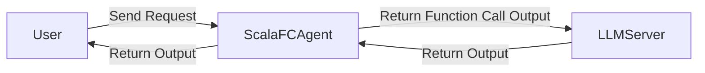
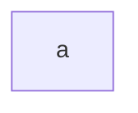

# function-calling-made-by-FP
関数型言語でFunction Calling Frameworkを実装する。ScalaFCAgentはLLMServerとUserの間に立ち, Userからのリクエストを振り分け, Toolの呼び出しを行いLLMServerに返す処理を担当する。


ScalaFCAgentはOpenAI API互換のあるリクエストを対象に処理を行う。



# Prompt設計
Functionの呼び出しは以下のようになる。

# How to use
- 公開用APIの`class Agent`に`trait Tool`を継承したclassを使う。
- Configを書く
- TODO: Write how to use
## Tool
- Toolは以下のTraitを継承することで使えるようになる
- ToolはLLMから来る未検証の入力と型安全な処理の境界として置く(まだ書かないでおく, 意外とむずい)
```
case class ToolError(message: String)

enum ToolResult {
  case Success(value: String)
  case Error(message: String)
}

trait Tool[A] {
  def name: String
  def description: String

  def schema: Schema[A]

  def parse(input: String): Either[ToolError, A]

  def run(args: A): IO[ToolResult]

  final def execute(input: String): IO[ToolResult] =
    parse(input) match {
      case Right(args) => run(args)
      case Left(error) => IO.pure(ToolResult.Error(error.message))
    }
}
```

# 開発工程

- [ ] 設計
- [ ] 1リクエストでToolが呼べるEngineを作成する(CLIでテストできるようにする)
- [ ] 複数リクエストを捌くScalaFCAgent Appを作成する(curlでのリクエストが動くようになる)

# 何故こんなプロジェクトを始めてしまったのか
- Scalaの関数型プログラミングとデフォルトで備え付けられている強力な正規表現能力とcase文がFunction Callと良い影響があると思っていた
- 関数呼び出しはYAMLのような型とXMLのような型があるので, それはparseで関数として処理する。(Function Nameと引数さえ取れればよい, Parseできる)
