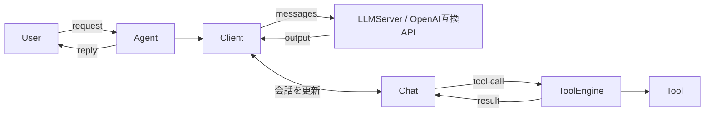

# function-calling-made-by-FP

LLM Server (OpenAI互換API) とユーザーの間に立ち, Tool呼び出し (Function Calling) を仲介するScalaライブラリ。
cats-effectの`IO`と不変な`Chat`で, LLMとの会話とTool実行を組み立てる。

- コアの`lib`はライブラリ。`Agent`がユーザーとLLMServerの間を仲介する
- Toolを登録すると, その使い方 (呼び出し形式) が初期のsystem promptに自動で載る
- Toolを登録しなければ, 普通のユーザーとLLMServerの会話として使える
- モデルごとのTool呼び出し形式の差は`ChatFormat`で吸収し, 本番コードにモデル固有の処理を置かない
- 1リクエストにつき1応答 (HTTPでは`stream: true`でSSEにも対応)

## 構成



| モジュール | 内容 |
| --- | --- |
| `lib` | Function Callingの中核。`Agent`を提供する |
| `server` | HTTPラッパー (OpenAI互換)。コアに重い依存を持ち込まないため別モジュール |

```
lib/     # コア (Agent / Client / Chat / Tool / LLMServer)
server/  # HTTPラッパー (Pekko HTTP)
docs/    # ドキュメント
```

## ドキュメント

GitHub Pages: https://superhotdogcat.github.io/ScalaFCAgent/

- [Quick Start](docs/quickstart.md)
- [Reference: コア (Agent / Chat / Tool / LLMServer / Client)](docs/reference/core.md)
- [Reference: HTTPサーバ (server)](docs/reference/http-server.md)

## コンポーネントと責務

| コンポーネント | 責務 |
| --- | --- |
| `Agent` | 公開API。ユーザーとLLMServerの仲介。1つの`Agent`が1会話 |
| `Client` | 送受信ループ。LLMServerへの送信, Tool呼び出しの解決, Toolが無くなるまでの繰り返し |
| `Chat` | 実行中の会話。`Role`付きの`messages`と`ChatFormat`を保持する |
| `ChatFormat` | サーバーが関与しない部分 (Tool呼び出し・結果の形式) だけを担う |
| `ToolEngine` / `Tool` / `TypedTool` | 名前からToolを引き, 型安全に引数を復元して実行する |
| `LLMServer` | 外部 (vLLM, Ollamaなど) のOpenAI互換APIへのトランスポート |

## Prompt設計

Toolの呼び出しと結果は以下の形式でやり取りする。

```
<tool>
{
    "function_name": String,
    "arguments": String (JSON)
}
</tool>
```

```
<tool_result>
String
</tool_result>
```

それ以外の会話は, OpenAI互換APIの`messages`として`Role`ごとに分けて送る。ロールのタグ付け (chat template) は接続先のOpenAI互換サーバが行うためこちらでは行わず, こちらが面倒を見るのはサーバーが関与しない`<tool>` / `<tool_result>`の形式だけ。

```json
{"messages":[
  {"role":"system","content":"... (Toolの説明を含む)"},
  {"role":"user","content":"..."},
  {"role":"assistant","content":"..."}
]}
```

`Role`の写像は以下の通り。

| Role | OpenAI互換APIのrole |
| --- | --- |
| `Role.System` | `system` |
| `Role.User` | `user` |
| `Role.Assistant` | `assistant` |
| `Role.Thinking` | `assistant` |
| `Role.Tool` | `user` (ネイティブのtools APIを使わないため) |

Toolsが無い場合は`system` / `user` / `assistant`だけになり, 普通のユーザーとLLMServerの会話になる。

## 使い方

### ライブラリ

`TypedTool`を継承したToolを`Agent`に登録する。

```scala
Agent.create(llm, new MyTool).use { agent =>
  agent.send("今の東京の時刻を教えて").flatMap(IO.println)
}
```

全体の例は[Quick Start](docs/quickstart.md)を参照。

### HTTPサーバ (OpenAI互換)

```bash
# OllamaにつないでHTTPサーバを立てる
OLLAMA_MODEL=gemma4:e2b ./gradlew :server:runOllamaExample
```

```bash
# 別ターミナルから (ステートレスなのでmessagesを毎回渡す)
curl -s -X POST localhost:8080/v1/chat/completions -H 'Content-Type: application/json' \
  -d '{"model":"gemma4:e2b","messages":[{"role":"user","content":"今の東京の時刻を教えて"}]}'

# ストリーミング (SSE)
curl -s -N -X POST localhost:8080/v1/chat/completions -H 'Content-Type: application/json' \
  -d '{"model":"gemma4:e2b","messages":[{"role":"user","content":"1から5まで数えて"}],"stream":true}'
```

環境変数は`HOST` / `PORT` / `OLLAMA_HOST` / `OLLAMA_MODEL`で差し替えられる。
詳細は[Reference: HTTPサーバ](docs/reference/http-server.md)を参照。

## ビルド / テスト

JDK 21, Scala 2.13。

```bash
./gradlew test
```

## 制約 (やっていないこと)

- 会話の永続化はしない (HTTPはステートレス。履歴は毎回`messages`で送る)
- 認証・レート制限は未実装
- OpenAIのネイティブ`tools` APIは使わず, `<tool>`形式で独自に扱う (`tools` / `tool_choice`には未対応)
- `messages[].content`は文字列のみ (マルチモーダル未対応)

## 背景

- Function Callingの記述形式はXML風・JSON風など複数あるため, 形式を`ChatFormat`で差し替えられる形にしている
- Scalaのパターンマッチと正規表現で, Tool呼び出しの解析が素直に書けると考えた
